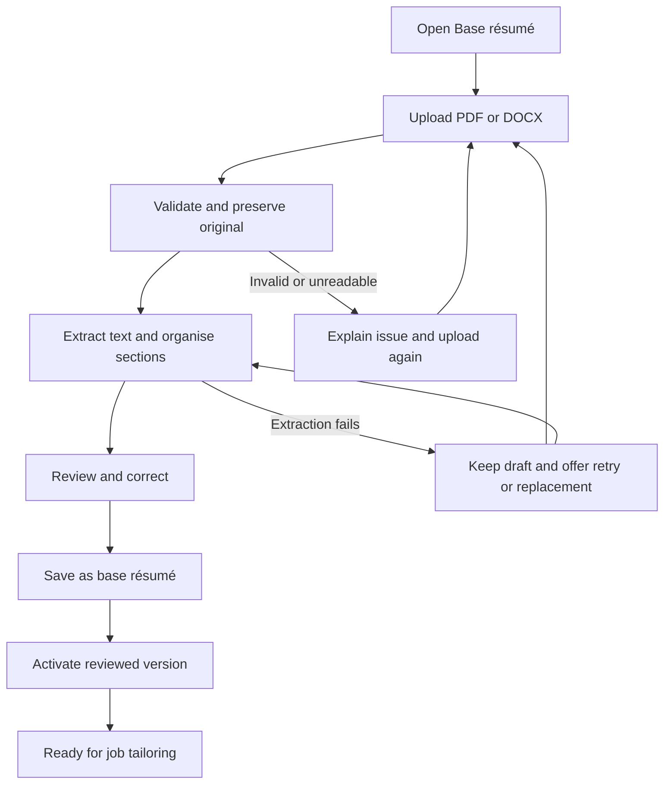

# Workflow 1: Base résumé setup

Status: backend workflow implemented and covered by HTTP integration tests with mocked AI where applicable. Real PDF rendering is exercised. The React frontend is implemented; live-provider and interactive browser verification remain pending. See [README.md](README.md) for the UI and launcher. See [backend/README.md](backend/README.md) for the implemented contracts and limits.

Purpose: establish a reviewed, reusable source of facts for future job-specific résumés and cover letters. Inputs are PDF or DOCX. Uploading a source does not generate a tailored document or change the fixed output template.

## User and backend journey

| Step | What the user does or sees | What the backend does |
| --- | --- | --- |
| 1. Open Base résumé | On first use, sees an upload area. On later visits, sees the current active résumé and an option to upload a replacement. | Loads the active résumé and any unfinished setup draft from SQLite. |
| 2. Upload | Drops or selects one PDF or DOCX. | Validates the file type and readability, saves the original under an application-generated path, calculates its hash, and creates a `resume_versions` record. |
| 3. Extract and organise | Sees progress while the résumé is processed. | Extracts text locally using the PDF/DOCX parser. Organises it into a structured draft, using AI if selected for this step. Validates the structure and flags missing or ambiguous information without inventing facts. |
| 4. Review and correct | Compares the extracted sections with the original résumé, fixes mistakes, and fills in any information they want included. | Saves the draft corrections separately from the original file and extracted text. Keeps the version in `needs_review`. |
| 5. Save as base résumé | Explicitly confirms that the reviewed content is accurate. | Validates required structure, marks the version `ready`, and activates it in one transaction. Records the review timestamp and deactivates the previous active version, if present. |
| 6. Reuse | Sees the saved base résumé and can proceed to Jobs on future visits. | Uses this active, reviewed version for new tailoring runs. Each run retains its source version and a frozen snapshot. |

## Review content

Show these editable groups, populated from the upload:

- Contact: name, email, phone, location, and links that are present.
- Professional summary, when present.
- Experience: employer, title, location, dates, and individual achievement bullets.
- Projects: name, links, and individual description or achievement bullets.
- Skills, preserving useful groupings.
- Education: institution, qualification, dates, and supporting details.
- Other source sections, such as certifications or awards, so unfamiliar sections are not silently lost.

Do not require the user to complete every group. Proposed minimum before activation: a name, meaningful résumé content, and explicit user confirmation. Missing contact details or ambiguous dates should be highlighted for review rather than filled in automatically. Exact validation rules remain to be finalised.

The original upload remains available beside the editable content. PDF preview and DOCX preview behavior can differ; the original file must remain downloadable in either case. Detailed screen layout is still pending.

Confirmed review behavior: show the actual extracted wording in an editing panel without rewriting it. The user reviews and edits the content. **Save draft** persists edits to `reviewed_content_json` while keeping `needs_review`; **Save as base résumé** persists edits and activates the approved version. AI may flag issues but does not approve facts on the user's behalf.

## Stored data and states

Use the existing `resume_versions` design in [DATABASE.md](DATABASE.md): original filename/path/type/hash, extracted text, reviewed structured content, status, error details, active flag, and timestamps. Draft edits use `reviewed_content_json`; `reviewed_at` remains empty until confirmation.

Normal state progression:

`uploaded → extracting → needs_review → ready`

Processing failures set `failed` with an actionable message. Retrying the same upload returns it to `extracting`; replacing the file creates a new version. A processing draft never becomes active automatically.

If AI organises the extracted text, preserve its raw response, validated draft, and provider/model metadata separately from user corrections. The implemented `intake_captures` and `ai_calls` tables retain these artifacts independently of user corrections; see [DATABASE.md](DATABASE.md).

## Returning, replacing, and correcting

- Reopening Jab restores the active résumé and saved review draft; uploading again is unnecessary.
- Uploading a replacement leaves the existing résumé active until the replacement is reviewed and activated.
- Editing an already approved résumé creates a new draft version. It may reuse the same immutable original upload reference.
- Activating a newer version affects future runs. Previous runs and submitted documents retain their historical inputs and files.
- Multiple historical versions are allowed; at most one is active.

## Failure behavior proposed for the MVP

| Situation | Behavior |
| --- | --- |
| Unsupported, corrupt, or password-protected file | Explain the problem and request a readable PDF/DOCX. Do not activate it. |
| Scanned PDF with no usable text | Explain that text extraction failed and request a text-based PDF or DOCX. OCR is proposed outside the first release, pending a decision. |
| Extraction misses or misorders content | Keep the original visible and allow corrections before activation. Successful parsing alone does not prove completeness. |
| AI organisation fails | Preserve the upload and extracted text; offer retry and show the failure. Keep any existing active résumé usable. |
| Jab closes during processing | On restart, identify unfinished processing and offer retry. Preserve saved draft corrections. |
| Saving fails | Report that saving did not complete; keep the previous active version and allow retry. |

## Decisions still needed

1. Whether structured extraction uses AI initially, and which provider/model it uses. If cloud AI is selected, résumé content leaves the computer for that request even though Jab runs locally.
2. Exact extraction response schema, section handling, and activation validation.
3. Confirmation of the proposed no-OCR scope and the upload size limit.
4. Review-screen layout and how corrections and extraction warnings are displayed.

## Acceptance checks

1. Upload either supported format, review the extracted facts, activate the source, and reopen Jab without uploading again.
2. Correct an extraction error and verify future tailoring receives the corrected facts.
3. Upload an invalid replacement and verify the existing base résumé remains active.
4. Activate a replacement and verify earlier generation runs still reference their original source.
5. Preserve unfamiliar sections and flag ambiguous content instead of silently dropping or inventing information.
