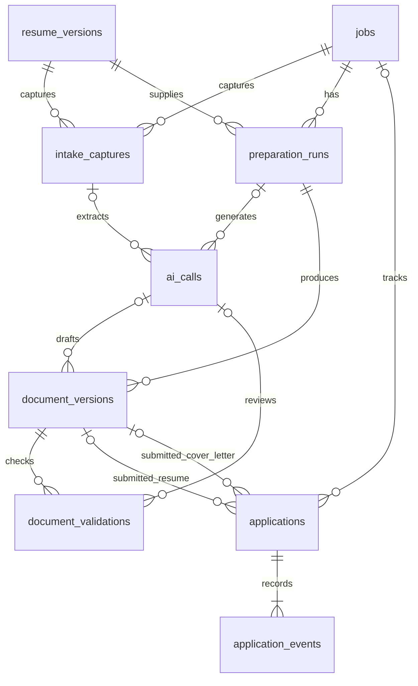

# Jab database design

Status: SQLite persistence layer implemented and tested on November 5, 2026. The database exists at `data/jab.sqlite3`. The HTTP backend, extraction, model adapter, controlled rendering and workflow orchestration are implemented. The React UI is implemented; live-provider and interactive browser verification remain pending. The frontend integration adds read endpoints without changing tables or migrations. See [backend/README.md](backend/README.md) for commands and operation contracts.

Use SQLite at `data/jab.sqlite3`. Store originals and generated PDFs on disk, with relative paths in database records. Ten domain tables cover the five workflows, including raw intake, AI call history, and per-revision validation. A small `schema_migrations` table records applied SQL migrations.

## Relationships

An application can be entered manually without a job, generation run, or document references. A job can be prepared many times. Reapplying can create another application for the same job; never enforce uniqueness on company or title.

## Common conventions

- Primary keys: `id INTEGER PRIMARY KEY`.
- Foreign keys: matching integer IDs, enforced on every database connection.
- Timestamps: UTC ISO 8601 text; date-only user inputs such as `applied_on` and `next_action_due_on` use `YYYY-MM-DD`.
- Structured document bodies and source snapshots: validated JSON stored as text. Searchable business fields remain normal columns.
- Required strings must be nonempty after trimming; constrain state values with SQL checks.
- Use nullable fields only where absence has meaning. Do not use fake values such as an empty company name or an invented application date.
- File paths are application-generated and relative to `data/`; preserve original upload names separately for display.

## 1. resume_versions

One upload and its reviewed source facts. Reviewing creates the factual baseline used by generation.

| Field | Purpose |
| --- | --- |
| id | Version identity |
| parent_resume_id | Prior ready version when an edit creates a draft child |
| original_filename | User-visible uploaded filename |
| file_path | Immutable original PDF/DOCX location |
| file_type | `pdf` or `docx` |
| sha256 | Original file integrity fingerprint; indexed if needed, not unique |
| extracted_text | Raw extracted text; nullable until extraction succeeds |
| reviewed_content_json | User-reviewed contact, summary, experience, skills, projects, and education; nullable until available |
| status | `uploaded`, `extracting`, `needs_review`, `ready`, or `failed` |
| error_message | Extraction failure details, if any |
| is_active | Integer boolean identifying the source for new runs |
| created_at, updated_at, reviewed_at | Upload, editing, and confirmation timestamps |

Only a `ready` version can be active. Enforce at most one active version through a partial unique index on `is_active` where it equals 1. Switch the active version in one transaction after review; a failed replacement leaves the old source active. Later corrections to a ready source create a new résumé version, retaining the original upload reference if unchanged. Earlier runs retain their source version and their own reviewed-content snapshot.

## 2. jobs

One saved opportunity, including a durable copy of its JD.

| Field | Purpose |
| --- | --- |
| id | Job identity |
| company, title | Required after intake review |
| location | Optional location/work arrangement text |
| advertised_salary, employment_type, application_deadline, recruiter_details, job_reference | Optional captured job metadata; deadline uses YYYY-MM-DD |
| tailoring_instructions | Optional user guidance, frozen into subsequent run inputs |
| expected_salary | Optional text for your desired compensation for this role; include currency and pay period, for example `INR 20–25 lakh per year`. This is your expectation, separate from any employer-advertised salary. |
| source_type | `pasted` or `url` |
| source_url | Supplied URL, required for URL intake; retained after paste fallback |
| jd_text | Captured or pasted job description |
| status | `needs_review`, `ready`, or `archived` |
| created_at, updated_at | Record timestamps |

During intake, allow missing company/title/JD while `needs_review`. Require nonempty values before setting `ready`. Retrieval errors can be returned to the interface while retaining the draft job. Do not use this status to represent application progress. URL is not unique; warn about likely duplicates without blocking legitimate reapplications.

## 3. preparation_runs

One generation attempt using specific, frozen inputs. A retry creates another run.

| Field | Purpose |
| --- | --- |
| id, job_id, resume_version_id | Run and required input relationships |
| source_document_id | Optional originating document for an AI revision; must belong to the same job |
| source_snapshot_json | Frozen reviewed résumé content, company/title/JD, and any generation guidance actually used |
| status | `queued`, `running`, `succeeded`, `partial`, `failed`, or `interrupted` |
| provider, model | Actual generation service and model |
| prompt_version, template_version | Identify the instruction and rendering revisions used |
| review_findings_json | Grounding, missing-information, and quality findings when available |
| error_message | Useful failure details, excluding secrets |
| created_at, started_at, finished_at | Lifecycle timestamps |

One document may succeed while the other fails; preserve it and mark the run `partial`. Runs left queued/running at restart become interrupted. Never keep a database transaction open during a network request or PDF compilation.

## 4. document_versions

One immutable saved revision of a résumé or cover letter. The interface may hold unsaved edits; saving creates a new row.

| Field | Purpose |
| --- | --- |
| id, run_id | Document identity and originating run |
| parent_document_id | Previous saved revision of the same kind; cross-run parents must be the run’s declared revision source |
| ai_call_id | Optional successful AI call from this run that supplied the draft |
| kind | `resume` or `cover_letter` |
| revision | Positive revision number, unique within `(run_id, kind)` |
| content_json | Validated editable document structure and text |
| pdf_path, pdf_sha256 | Export location and fingerprint; nullable before successful rendering |
| render_status | `pending`, `ready`, or `failed` |
| render_error | Rendering failure information if any |
| created_at, rendered_at | Revision and export timestamps |

Only render fields may change to complete or retry rendering of the same content. Content changes always create a new row, even after submission. A ready export requires its path, hash, and rendering timestamp. Do not replace the file associated with an existing ready revision. Determine the latest revision by revision number instead of storing another mutable pointer.

## 5. applications

One actual submission, including submissions prepared outside Jab.

| Field | Purpose |
| --- | --- |
| id | Application identity |
| origin | `jab` or `external`; applies different submission prerequisites |
| job_id | Optional saved job relationship |
| company, role | Required snapshot of company and role at submission; independent of later job edits |
| application_url | Optional destination URL |
| applied_on | Submission date; nullable for older manually entered applications with an unknown date |
| stage | `applied`, `screening`, `interviewing`, `offer`, `accepted`, `rejected`, or `withdrawn` |
| resume_document_id | Optional exact résumé revision used |
| cover_letter_document_id | Optional exact cover-letter revision used |
| next_action, next_action_due_on | Optional follow-up text and date |
| created_at, updated_at | Record timestamps |

Recording a Jab-prepared submission requires a supplied applied date and at least its ready résumé PDF; link the cover letter only if it was actually submitted. Document selection may combine different runs for the same job. External applications can omit both document references. Never infer submission from generation or download.

Submitted document references are locked after recording. Any correction is explicit and creates an event containing old/new references; it does not alter the referenced content or file. This accommodates an incorrect initial selection without losing the audit trail.

## 6. application_events

Append-only application history.

| Field | Purpose |
| --- | --- |
| id, application_id | Event identity and parent |
| kind | `submission_recorded`, `stage_changed`, `note_added`, `next_action_changed`, `submission_corrected`, or `details_corrected` |
| occurred_at | When the event happened, including a user-supplied past time if known |
| recorded_at | When Jab saved it |
| note | Human-readable note; required for note events |
| details_json | Structured old/new stage, follow-up, submission references, or corrected details as appropriate |

Create the application and its initial event together. Change its stage or next action and append the corresponding event in one transaction. Corrections append events rather than rewriting history. Store the current stage on the application for simple filtering; events explain how it got there.

## 7. intake_captures

Each retrieval, paste, or extraction attempt has its own record, separate from editable reviewed fields. Exactly one of `resume_version_id` and `job_id` owns it. `capture_type` is `resume_text`, `pasted_jd`, or `fetched_jd`; `resume_text` requires a résumé owner. Store `supplied_url`, `captured_text`, `status` (`pending`, `running`, `succeeded`, `failed`, `interrupted`), `error_message`, and `created_at`. Captured text can be preserved even on failure. Terminal attempts cannot be edited; create a new capture for retries. A URL failure followed by pasted text retains both attempts and the original job URL.

## 8. ai_calls

Exactly one of `intake_capture_id` and `run_id` owns each call. Store `purpose`, `provider`, `model`, `request_json`, `raw_response`, `validated_response_json`, `token_usage_json`, `status` (`pending`, `running`, `succeeded`, `failed`, `interrupted`), `error_message`, `started_at`, and `finished_at`. This keeps raw AI output distinct from validated content and later user edits. Request metadata never includes credentials or transport headers; the provider adapter must omit secrets from errors/responses too. Terminal calls are immutable. Retries create new rows.

## 9. document_validations

Append-only findings against one exact `document_id`: `check_type` (`structure`, `facts`, `ai_review`, `pdf`), `result` (`passed`, `warnings`, `failed`), `findings_json`, optional `ai_call_id`, and `created_at`. An AI review must reference a successful call from the document's own run when a call ID is supplied. Required structure, facts, and PDF checks must exist before readiness. The latest result per check type governs readiness; any latest failure blocks it. Warnings remain visible for user review. Ready revisions freeze their checks; corrections create a new document revision. These records persist checker results; they do not themselves perform factual or layout validation.

## 10. processing_tasks

Backend migration 003 adds durable task records for résumé extraction, job intake, generation, AI revision and PDF rendering. Each row references exactly one matching owner (résumé, job, run, or document), with immutable input metadata, state, processing step, result, error and timestamps. Partial unique indexes prevent concurrent active tasks on the same owner; service checks also prevent conflicting operations for a job. Terminal tasks are immutable and retained in backups. Startup marks unfinished tasks interrupted without automatically repeating inference requests.

The same migration adds `jobs.requirements_json` for responsibilities and required/preferred qualifications. Confirmed requirements are decoded into frozen generation snapshots. This is an additive backend integration migration; existing source, document and application records remain unchanged.

## Integrity and indexes

- Use foreign keys with restrictive deletion for linked rows; archive jobs instead of deleting application evidence. No automatic cascade deletion of history.
- Both backend operations and SQL triggers validate submitted document readiness, kind, and job ownership. Backend operations also check file existence and SHA-256. Triggers enforce run source readiness, revision parent relationships, successful AI-call provenance, immutable approved sources, and append-only histories. Application changes must use the transactional operations to append matching events; arbitrary SQL edits bypass that service-level audit contract.
- Index every foreign-key column used in joins, plus application `(stage, applied_on)`, events `(application_id, occurred_at, id)`, and runs `(job_id, created_at)`.
- Unique indexes: one active résumé and `(run_id, kind, revision)` on document versions.
- Use parameterized SQL. Do not add a users table, separate company table, or separate skills/education tables for this single-user MVP. Reviewed résumé content is a versioned document; company and role remain on jobs and submission snapshots.
- Track migration versions separately; make schema changes through ordered migrations rather than recreating the database.

SQLite supports the proposed primary key, foreign key, unique, not-null, and check constraints. Enable `PRAGMA foreign_keys = ON` on each connection and verify it. References: [SQLite foreign keys](https://www.sqlite.org/foreignkeys.html), [table constraints](https://www.sqlite.org/lang_createtable.html).

## Files and recoverability

Write an export to a temporary file, validate it, and move it to a unique permanent path before marking its revision ready. File writes and database commits are not one atomic transaction: recover orphaned temporary files, and detect missing/hash-mismatched ready files without silently claiming they are downloadable. Preserve immutable content so a replacement can be explicitly generated and checked.

Implemented backup holds a SQLite write reservation while taking a backup-API snapshot and copying referenced files. It checks migration history, integrity, foreign keys, file paths, and hashes before publishing the bundle. Restore performs the same verification into a new directory and never overwrites live data. See [backend/README.md](backend/README.md).

## Verified persistence checks

1. Replace the active résumé without changing past run inputs or submission PDFs.
2. Edit the JD and confirm a previous run still exposes its original snapshot.
3. Save an edited document as a new revision; the submission retains the older revision.
4. Record and update an application with matching timeline events atomically.
5. Add an external application with no job/documents and an unknown historical date.
6. Reject wrong-kind, wrong-job, or unfinished PDFs as submitted documents.
7. Preserve partial results and recover interrupted generation after restart.
8. Back up and restore the records and files without broken relationships.

All eight checks above are covered in the 20-test standard-library suite, including fixture-based full workflows, upgrade from the initial schema, write locking during backups, event rollback, invalid submissions, and corrupted restore rejection. These are persistence checks; real PDF compilation, AI quality, HTTP endpoints, and UI acceptance checks remain pending.

## Explicit link approval (migration 004)

`resume_versions.validation_overrides_json` records the link warnings a user explicitly accepted on activation. It is frozen once that version is ready and included in preparation snapshots. The reviewed content stays unchanged. A newly edited base version requires its own approval; document checks only downgrade unchanged matching source links to warnings, and the renderer prints invalid values as escaped plain text.

## Hyperlink content version 2

Inline spans, labelled contact links and unresolved associations live in the existing reviewed-content, document-content and frozen-snapshot JSON fields. This update adds no SQL tables or columns. Version 1 JSON remains immutable and is adapted at application boundaries. Re-import shares the original file/hash in a new child `resume_versions` row and uses the existing extraction task/capture/AI-call history. Source IDs, URLs and span positions are frozen with each reviewed version/run. Historical PDF files and submitted references are untouched.
